

<a href="https://arcangelo.net">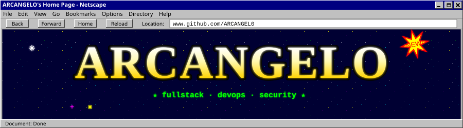</a>

 

<a href="#">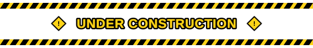</a>

<a href="#">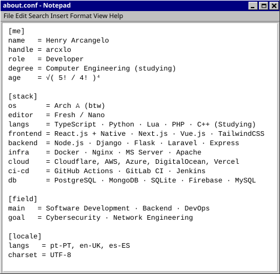</a>
<a href="https://www.youtube.com/watch?v=qTsaS1Tm-Ic" target="_blank">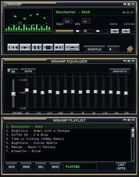</a>

<b style="color:#C0C0C0">✦ MOTD:</b>

> "Intelligence is the ability to avoid doing work, yet getting the work done." — Linus Torvalds

**C:\ARCANGEL0**

├─ <a href="https://arcangelo.net"><b>web</b></a> 
│  └─ <a href="https://terminal.arcangelo.net"><b>terminal</b></a> 
├─ <a href="https://discord.com/users/716015207713079447"><b>discord</b></a> 
├─ <a href="https://codepen.io/arcxlo_"><b>codepen</b></a> 
├─ <a href="mailto:henry@arcangelo.net"><b>email</b></a> 
├─ <a href="https://wa.me/351927285125"><b>whatsapp</b></a> 
└─ <a href="https://www.steamcommunity.com/id/arcxlo"><b>steam</b></a>

<b style="color:#00FF00">▓▒░ REPO ARCHIVE ░▒▓</b> 
100% FOSS

<a href="https://github.com/ARCANGEL0/mitsu">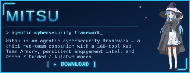</a>
<a href="https://github.com/ARCANGEL0/CyberArch-Shell">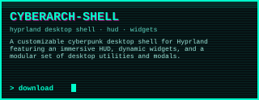</a>
<a href="https://github.com/ARCANGEL0/MiSide-sddm-theme">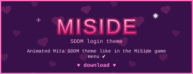</a>

<a href="https://github.com/ARCANGEL0/OnionChat">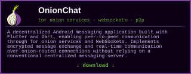</a>
<a href="https://github.com/ARCANGEL0/webPsx">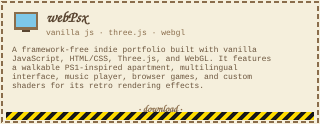</a>

<a href="https://github.com/ARCANGEL0/ArcxlOS">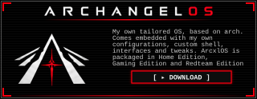</a>

## activity

<b>telemetry.exe</b>

 

<a href="#">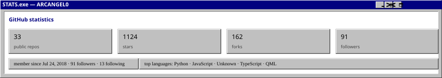</a>

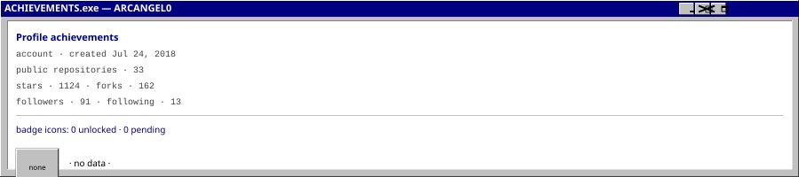

<a href="#">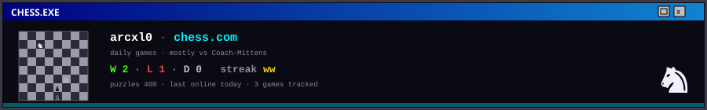</a>

<picture>
  <source media="(prefers-color-scheme: dark)" srcset="https://raw.githubusercontent.com/ARCANGEL0/ARCANGEL0/output/github-contribution-grid-snake-dark.svg" />
  <source media="(prefers-color-scheme: light)" srcset="https://raw.githubusercontent.com/ARCANGEL0/ARCANGEL0/output/github-contribution-grid-snake.svg" />
  
</picture>

**`▪ languages`**

**`▪ web & frameworks`**

**`▪ InfraOps / Cloud / Databases`**

**`▪ data & tools`**

**`▪ os & hardware`**

<b>sudo opsec</b>

 

**`▪ recon, osint & scanning`**

**`▪ exploitation & web apps`**

**`▪ passwords · ad & privesc`**

**`▪ post-ex, c2 & tunneling`**

**`▪ wireless & sniffing`**

**`▪ reverse eng & mobile`**

**`▪ hardware & social engineering`**

**`▪ adversary emulation, blue team`**

 
<a href="https://www.blender.org">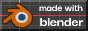</a>

 

<a href="https://bittorrent.com">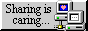</a>

 

 

 

 

<a href="https://www.winamp.com">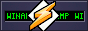</a>
 

<a href="https://angusnicneven.com/">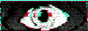</a> 

 

 

· © 1998–2007 ARCANGEL0 ·

