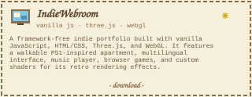

<table width="100%;" border="0">
<tr><td align="center">

 

</td></tr>
</table>

<table align="center" width="100%">
  <tr>
<td width="62%" valign="top" style="border:none;">

<table width="100%">
<tr><td style="border:none;">

<b style="color:#C0C0C0">✦ MOTD:</b>

> "Intelligence is the ability to avoid doing work, yet getting the work done." — Linus Torvalds

</td></tr>
</table>

</td> <td width="38%" valign="top" style="border:none;">

 

  

<table width="100%">
<tr><td style="border:none;">

**C:\ARCANGEL0**

├─ <a href="https://arcangelo.net"><b>web</b></a> 
│  └─ <a href="https://terminal.arcangelo.net"><b>terminal</b></a> 
├─ <a href="https://discord.com/users/716015207713079447"><b>discord</b></a> 
├─ <a href="https://codepen.io/arcxlo_"><b>codepen</b></a> 
├─ <a href="mailto:henry@arcangelo.net"><b>email</b></a> 
├─ <a href="https://wa.me/351927285125"><b>whatsapp</b></a> 
├─ <a href="https://www.steamcommunity.com/id/arcxlo"><b>steam</b></a> 
└─ <a href="https://open.spotify.com/user/31jditvlpdtkmavupdm35nnxxdx4"><b>spotify</b></a>

</td></tr>
</table>

</td>
  </tr>
</table>

<table width="100%">
<tr><td>

<b style="color:#00FF00">▓▒░ REPO ARCHIVE ░▒▓</b> 
100% FOSS

<table width="100%" cellspacing="10" cellpadding="0">
<tr><td width="50%" valign="top"></td><td width="50%" valign="top"></td></tr>
<tr><td width="50%" valign="top"></td><td width="50%" valign="top"></td></tr>
<tr><td width="50%" valign="top"></td><td width="50%" valign="top"></td></tr>
<tr><td width="50%" valign="top"></td><td width="50%" valign="top"></td></tr>
</table>

</td></tr>
</table>

## activity

<table width="100%">
<tr><td align="center">

<b>Github telemetry</b>

 

<table width="100%" cellspacing="10" cellpadding="0">
<tr><td width="50%" valign="top">

</td><td width="50%" valign="top">

</td></tr>
</table>

<table width="100%" cellspacing="10" cellpadding="0">
<tr><td valign="top"></td></tr>
</table>

<table width="100%" cellspacing="10" cellpadding="0">
<tr><td width="50%" valign="top"></td><td width="50%" valign="top"></td></tr>
<tr><td width="50%" valign="top"></td><td width="50%" valign="top"></td></tr>
<tr><td colspan="2" valign="top"></td></tr>
</table>

<picture>
  <source media="(prefers-color-scheme: dark)" srcset="https://raw.githubusercontent.com/ARCANGEL0/ARCANGEL0/output/github-contribution-grid-snake-dark.svg" />
  <source media="(prefers-color-scheme: light)" srcset="https://raw.githubusercontent.com/ARCANGEL0/ARCANGEL0/output/github-contribution-grid-snake.svg" />
  
</picture>

</td></tr>
</table>

<table width="100%">
<tr><td width="20%"></td><td width="60%">

<table width="100%" cellspacing="10" cellpadding="0">
<tr><td width="50%" valign="top">

**`▪ languages`**

</td><td width="50%" valign="top">

**`▪ web & frameworks`**

</td></tr>
<tr><td width="50%" valign="top">

**`▪ ops & infra`**

</td><td width="50%" valign="top">

**`▪ data & tools`**

</td></tr>
<tr><td colspan="2" valign="top">

**`▪ os & hardware`**

</td></tr>
</table>

<b>sudo opsec</b>

 

<table width="100%" cellspacing="10" cellpadding="0">
<tr><td width="50%" valign="top">

**`▪ recon, osint & scanning`**

</td><td width="50%" valign="top">

**`▪ exploitation & web apps`**

</td></tr>
<tr><td width="50%" valign="top">

**`▪ passwords · ad & privesc`**

</td><td width="50%" valign="top">

**`▪ post-ex, c2 & tunneling`**

</td></tr>
<tr><td width="50%" valign="top">

**`▪ wireless & sniffing`**

</td><td width="50%" valign="top">

**`▪ reverse eng & mobile`**

</td></tr>
<tr><td width="50%" valign="top">

**`▪ hardware & social engineering`**

</td><td width="50%" valign="top">

**`▪ adversary emulation, blue team`**

</td></tr>
</table>

</td><td width="20%"></td></tr>
</table>

<table align="center" width="100%">
<tr><td align="center">

</td></tr>
</table>

 

 

 

 

 

 

 

· © 1998–2007 ARCANGEL0 ·

